# ChatMind 2.0 Feature Workflows

## 1. Hyper-Localized AI Coaching System

### 1.1 Enhanced AI Coaching Workflow

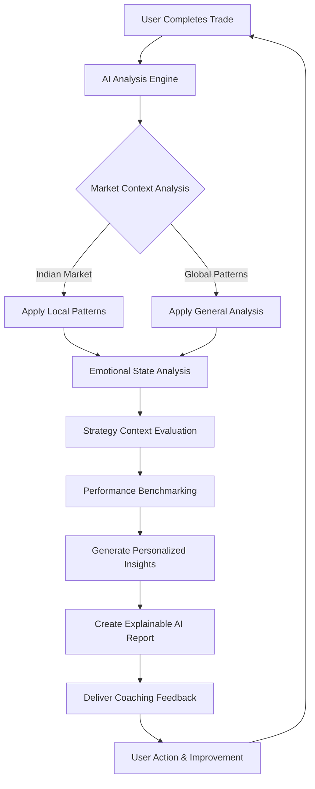

### 1.2 Coach Persona Selection Workflow

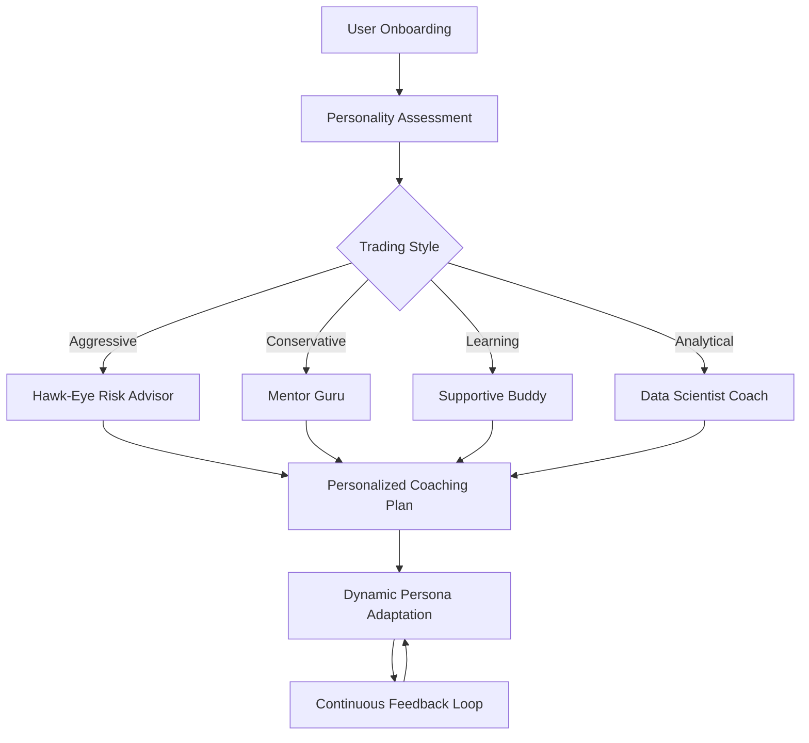

## 2. Multi-Broker Integration System

### 2.1 Broker Connection Workflow

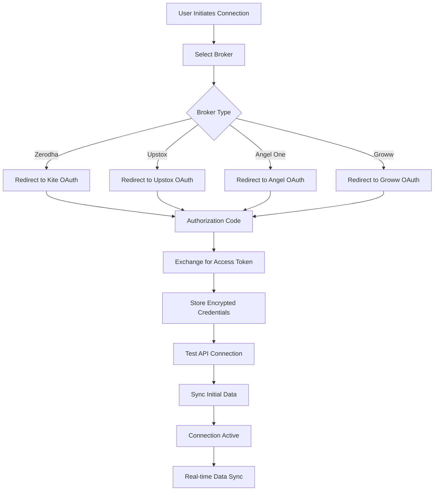

### 2.2 Multi-Account Aggregation Workflow

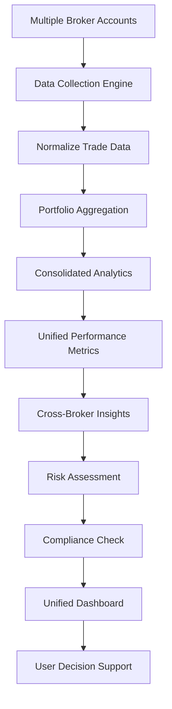

## 3. Social & Gamification Features

### 3.1 Trade Story Sharing Workflow

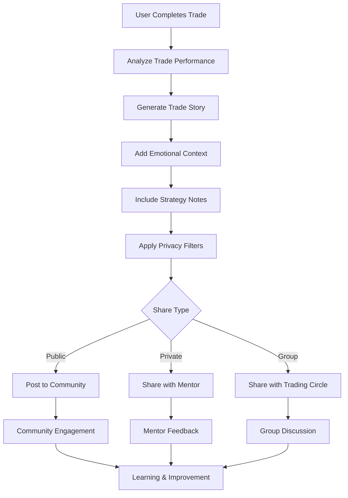

### 3.2 Achievement System Workflow

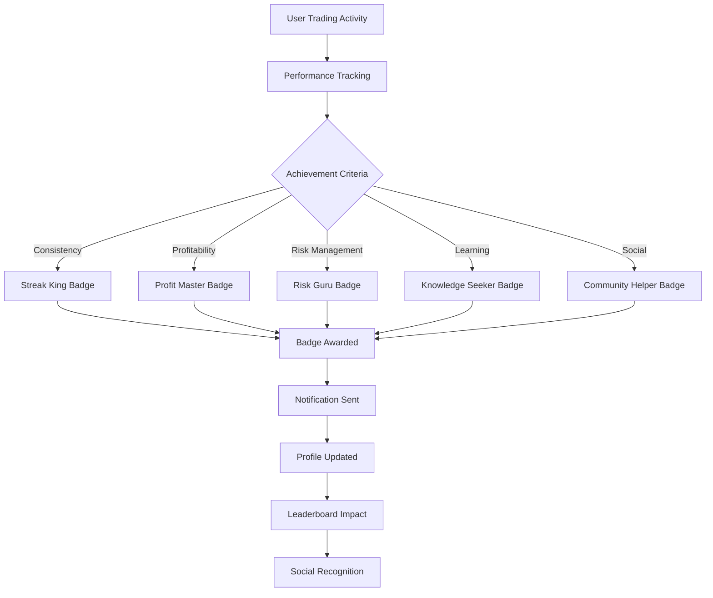

## 4. Compliance & Security Framework

### 4.1 eKYC Verification Workflow

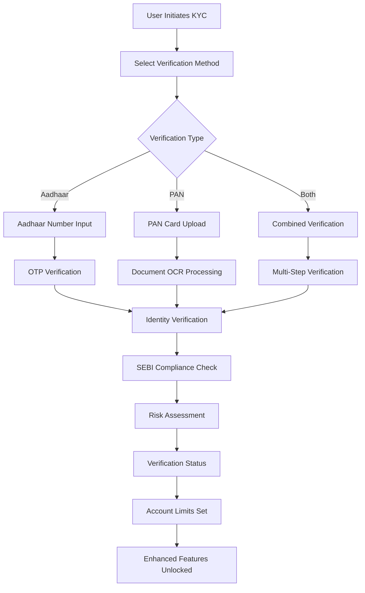

### 4.2 Compliance Monitoring Workflow

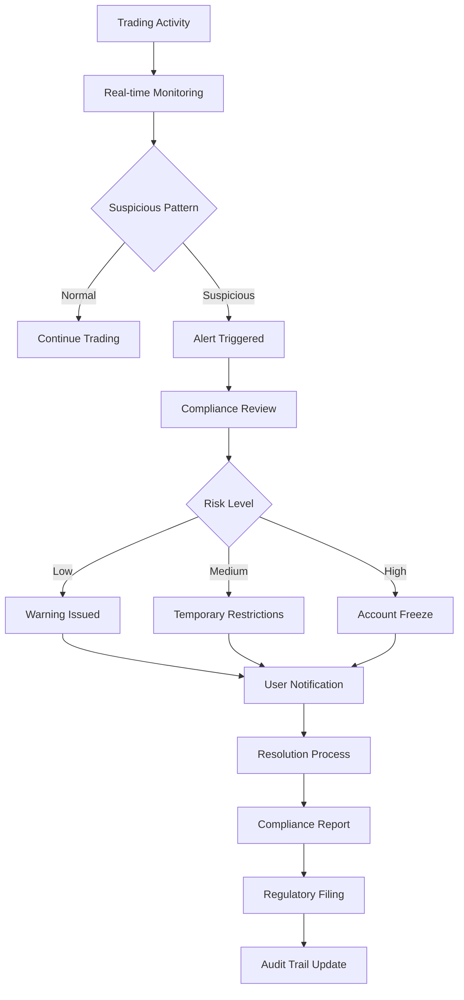

## 5. Enhanced User Experience

### 5.1 Personalized Dashboard Workflow

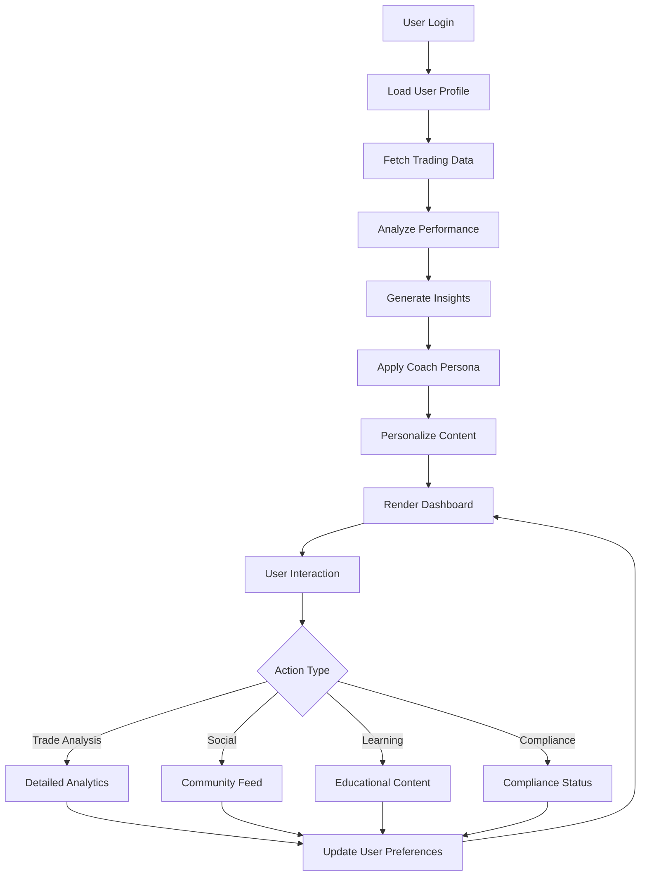

### 5.2 Learning & Improvement Workflow

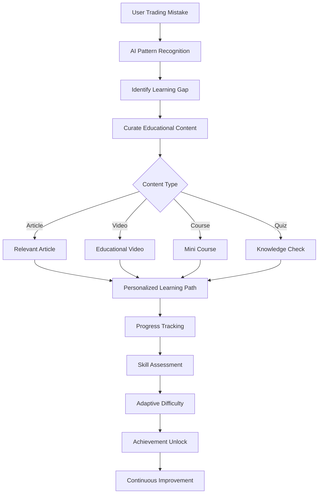

## 6. Technical Implementation Workflows

### 6.1 Data Synchronization Workflow

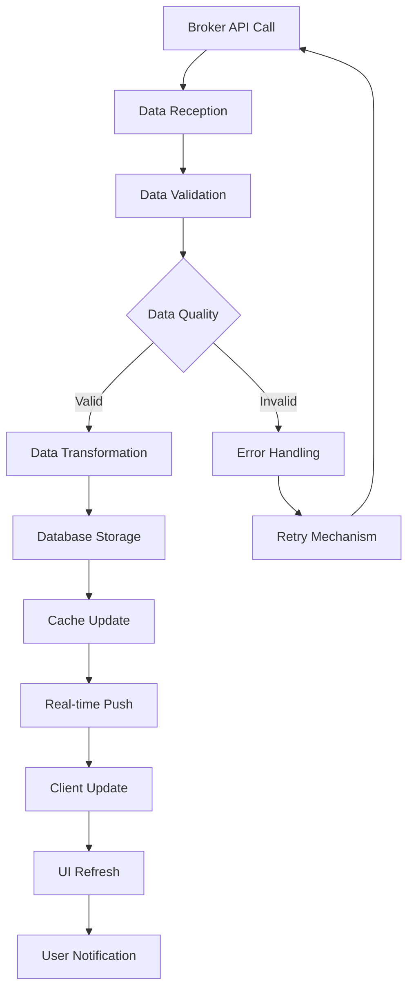

### 6.2 AI Processing Workflow

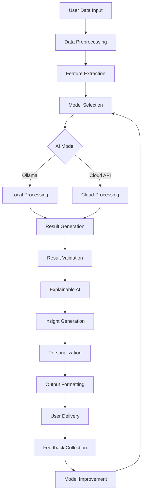

## 7. Integration Workflows

### 7.1 Third-Party Integration Workflow

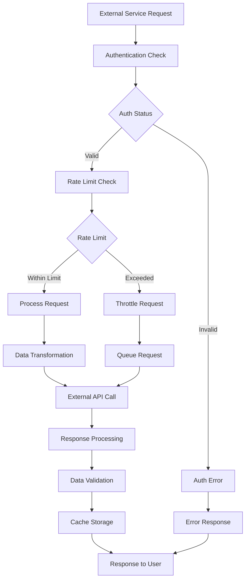

### 7.2 Notification System Workflow

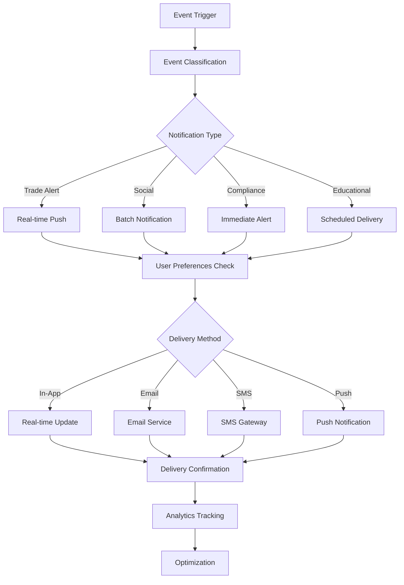

These workflows provide a comprehensive view of how the enhanced ChatMind platform will operate across all major features, ensuring seamless integration and optimal user experience.
