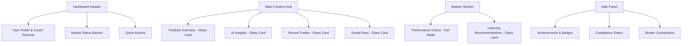
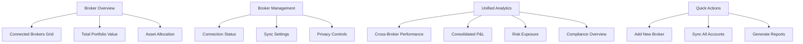
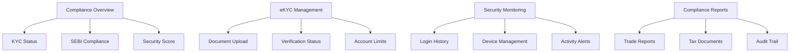

# ChatMind 2.0 UI Mockups & Design System

## Design Philosophy

ChatMind 2.0 embraces a **"Smart Trading, Indian Soul"** design philosophy that combines:
- **Glassmorphism**: Modern, translucent interfaces with depth and layering
- **India-Centric Aesthetics**: Cultural elements, colors, and patterns
- **Data-Driven Design**: Clear information hierarchy and actionable insights
- **Accessibility**: WCAG 2.1 compliant with multi-language support

## Color Palette

### Primary Colors
```css
/* Indian Market Inspired */
:root {
  --primary-saffron: #FF9933;    /* Indian flag saffron */
  --primary-green: #138808;      /* Indian flag green */
  --primary-white: #FFFFFF;      /* Indian flag white */
  --primary-blue: #000080;       /* Indian navy blue */
  
  /* Trading Colors */
  --bullish-green: #00C851;      /* Profit/positive */
  --bearish-red: #FF4444;        /* Loss/negative */
  --neutral-gray: #6C757D;       /* Neutral/neutral */
  
  /* Glassmorphism */
  --glass-bg: rgba(255, 255, 255, 0.1);
  --glass-border: rgba(255, 255, 255, 0.2);
  --glass-shadow: 0 8px 32px 0 rgba(31, 38, 135, 0.37);
}
```

### Dark Mode Variants
```css
.dark {
  --glass-bg: rgba(0, 0, 0, 0.2);
  --glass-border: rgba(255, 255, 255, 0.1);
  --glass-shadow: 0 8px 32px 0 rgba(0, 0, 0, 0.5);
}
```

## Component Library

### 1. Glassmorphism Card Component

```typescript
// components/enhanced/glassmorphism/GlassCard.tsx
interface GlassCardProps {
  children: React.ReactNode;
  className?: string;
  variant?: 'default' | 'elevated' | 'bordered';
  blur?: 'sm' | 'md' | 'lg';
}

export const GlassCard: React.FC<GlassCardProps> = ({
  children,
  className = '',
  variant = 'default',
  blur = 'md'
}) => {
  const blurClasses = {
    sm: 'backdrop-blur-sm',
    md: 'backdrop-blur-md',
    lg: 'backdrop-blur-lg'
  };

  const variantClasses = {
    default: 'bg-glass-bg border-glass-border',
    elevated: 'bg-glass-bg/80 border-glass-border/50',
    bordered: 'bg-glass-bg border-2 border-glass-border'
  };

  return (
    <div className={`
      ${blurClasses[blur]}
      ${variantClasses[variant]}
      rounded-xl border shadow-glass
      ${className}
    `}>
      {children}
    </div>
  );
};
```

### 2. AI Coach Persona Component

```typescript
// components/enhanced/coachPersonas/CoachAvatar.tsx
interface CoachAvatarProps {
  persona: 'hawk-eye' | 'mentor' | 'buddy' | 'scientist';
  isActive?: boolean;
  size?: 'sm' | 'md' | 'lg';
}

export const CoachAvatar: React.FC<CoachAvatarProps> = ({
  persona,
  isActive = false,
  size = 'md'
}) => {
  const personaConfig = {
    'hawk-eye': {
      color: 'bg-red-500',
      icon: '🦅',
      name: 'Hawk-Eye Risk Advisor'
    },
    'mentor': {
      color: 'bg-blue-500',
      icon: '🧙‍♂️',
      name: 'Mentor Guru'
    },
    'buddy': {
      color: 'bg-green-500',
      icon: '🤝',
      name: 'Supportive Buddy'
    },
    'scientist': {
      color: 'bg-purple-500',
      icon: '🔬',
      name: 'Data Scientist Coach'
    }
  };

  const config = personaConfig[persona];
  const sizeClasses = {
    sm: 'w-8 h-8 text-sm',
    md: 'w-12 h-12 text-lg',
    lg: 'w-16 h-16 text-2xl'
  };

  return (
    <div className={`
      ${sizeClasses[size]}
      ${config.color}
      rounded-full
      flex items-center justify-center
      text-white font-bold
      ${isActive ? 'ring-4 ring-yellow-400 ring-opacity-50' : ''}
      transition-all duration-300
      hover:scale-110
    `}>
      {config.icon}
    </div>
  );
};
```

### 3. Indian Market Pattern Component

```typescript
// components/enhanced/indianMarket/MarketPattern.tsx
interface MarketPatternProps {
  pattern: 'budget' | 'ipo' | 'festive' | 'monsoon' | 'election';
  intensity: 'low' | 'medium' | 'high';
}

export const MarketPattern: React.FC<MarketPatternProps> = ({
  pattern,
  intensity
}) => {
  const patterns = {
    budget: {
      icon: '📊',
      color: 'bg-blue-100 text-blue-800',
      label: 'Budget Day'
    },
    ipo: {
      icon: '🚀',
      color: 'bg-green-100 text-green-800',
      label: 'IPO Season'
    },
    festive: {
      icon: '🎉',
      color: 'bg-yellow-100 text-yellow-800',
      label: 'Festive Season'
    },
    monsoon: {
      icon: '🌧️',
      color: 'bg-indigo-100 text-indigo-800',
      label: 'Monsoon Effect'
    },
    election: {
      icon: '🗳️',
      color: 'bg-purple-100 text-purple-800',
      label: 'Election Impact'
    }
  };

  const intensityClasses = {
    low: 'opacity-60',
    medium: 'opacity-80',
    high: 'opacity-100'
  };

  const config = patterns[pattern];

  return (
    <div className={`
      ${config.color}
      ${intensityClasses[intensity]}
      px-3 py-1 rounded-full text-sm font-medium
      flex items-center gap-2
    `}>
      <span>{config.icon}</span>
      <span>{config.label}</span>
    </div>
  );
};
```

## Key Screen Mockups

### 1. Enhanced Dashboard



**Dashboard Features:**
- **Glassmorphism cards** with backdrop blur effects
- **AI Coach avatar** with dynamic persona switching
- **Indian market patterns** overlay on charts
- **Real-time broker sync** status indicators
- **Social engagement** metrics and notifications
- **Compliance status** with visual indicators

### 2. AI Coaching Interface

```mermaid
graph TD
    A[Coaching Session Header] --> B[Current Coach Persona]
    A --> C[Session Type]
    A --> D[Progress Indicator]
    
    E[Analysis Panel] --> F[Trade Performance Breakdown]
    E --> G[Emotional State Analysis]
    E --> H[Strategy Effectiveness]
    E --> I[Market Context Impact]
    
    J[Insights Panel] --> K[Key Observations]
    J --> L[Actionable Recommendations]
    J --> M[Learning Resources]
    J --> N[Benchmark Comparison]
    
    O[Interaction Panel] --> P[Chat Interface]
    O --> Q[Quick Actions]
    O --> R[Feedback Options]
```



**Coaching Interface Features:**
- **Persona-specific** coaching styles and language
- **Explainable AI** with "why" analysis for each insight
- **Emotional intelligence** tracking with mood indicators
- **Interactive chat** for follow-up questions
- **Progress tracking** with improvement metrics
- **Benchmarking** against successful Indian traders

### 3. Multi-Broker Integration Dashboard



**Broker Integration Features:**
- **Unified dashboard** for all broker accounts
- **Real-time sync** status with visual indicators
- **Privacy controls** for data sharing preferences
- **Cross-broker analytics** with consolidated reporting
- **One-click sync** for all connected accounts
- **Compliance monitoring** across all brokers

### 4. Social Trading Interface

```mermaid
graph TD
    A[Social Header] --> B[Community Feed]
    A --> C[Leaderboard Tab]
    A --> D[Mentorship Tab]
    
    E[Trade Stories] --> F[Anonymous Trade Sharing]
    E --> G[Performance Attribution]
    E --> H[Strategy Discussion]
    E --> I[Learning Points]
    
    J[Leaderboard] --> K[Multiple Ranking Metrics]
    J --> L[Risk-Adjusted Returns]
    J --> M[Consistency Score]
    J --> N[Improvement Streak]
    
    O[Mentorship] --> P[Verified Coaches]
    O --> Q[Session Booking]
    O --> R[Reviews & Ratings]
```



**Social Trading Features:**
- **Anonymous trade sharing** with performance attribution
- **Multi-metric leaderboards** (profit, consistency, risk-adjusted)
- **Verified coach marketplace** with booking system
- **Community discussions** around strategies and market events
- **Achievement showcase** with India-specific badges
- **Learning circles** for group education

### 5. Compliance & Security Dashboard



**Compliance Features:**
- **eKYC verification** with Aadhaar/PAN integration
- **SEBI compliance** monitoring and reporting
- **Real-time security** monitoring with alerts
- **Automated document** generation for tax purposes
- **Comprehensive audit** trail for all activities
- **Privacy controls** with granular permissions

## Mobile App Design

### Responsive Design Strategy

```css
/* Mobile-first responsive breakpoints */
:root {
  --mobile-max: 768px;
  --tablet-min: 769px;
  --tablet-max: 1024px;
  --desktop-min: 1025px;
}

/* Mobile optimizations */
@media (max-width: 768px) {
  .glass-card {
    backdrop-blur-sm;
    border-radius: 12px;
  }
  
  .dashboard-grid {
    grid-template-columns: 1fr;
    gap: 12px;
  }
  
  .coach-avatar {
    width: 40px;
    height: 40px;
  }
}
```

### Mobile-Specific Features

1. **Gesture Navigation**: Swipe gestures for trade analysis and coaching sessions
2. **Voice Commands**: Voice-activated trading journal entries and queries
3. **Push Notifications**: Real-time alerts for trading opportunities and compliance updates
4. **Biometric Authentication**: Face ID/fingerprint for secure access
5. **Offline Mode**: Local storage for trading data with sync when online
6. **Dark Mode**: Optimized for low-light trading environments

## Accessibility Features

### 1. Multi-Language Support
- **Primary Languages**: English, Hindi, Tamil, Telugu, Bengali
- **Regional Terms**: Trading terminology in local languages
- **Cultural Context**: Market examples relevant to different regions

### 2. Visual Accessibility
- **High Contrast Mode**: Enhanced visibility for visually impaired users
- **Screen Reader Support**: Full compatibility with NVDA, JAWS
- **Color Blind Friendly**: Alternative color schemes for color blindness
- **Text Scaling**: Dynamic text resizing without layout breakage

### 3. Motor Accessibility
- **Keyboard Navigation**: Full keyboard accessibility
- **Voice Control**: Voice command support for all major functions
- **Touch Targets**: Large, easily tappable interface elements
- **Reduced Motion**: Options for users with vestibular disorders

## Design System Implementation

### Component Structure
```
src/components/
├── enhanced/
│   ├── glassmorphism/
│   │   ├── GlassCard.tsx
│   │   ├── GlassButton.tsx
│   │   └── GlassModal.tsx
│   ├── coachPersonas/
│   │   ├── CoachAvatar.tsx
│   │   ├── CoachInterface.tsx
│   │   └── PersonaSelector.tsx
│   ├── indianMarket/
│   │   ├── MarketPattern.tsx
│   │   ├── FestivalCalendar.tsx
│   │   └── BudgetDayTracker.tsx
│   ├── social/
│   │   ├── TradeStory.tsx
│   │   ├── Leaderboard.tsx
│   │   └── AchievementBadge.tsx
│   ├── broker/
│   │   ├── BrokerCard.tsx
│   │   ├── ConnectionStatus.tsx
│   │   └── PortfolioOverview.tsx
│   └── compliance/
│       ├── KYCStatus.tsx
│       ├── ComplianceMeter.tsx
│       └── SecurityDashboard.tsx
├── charts/
│   ├── enhanced/
│   │   ├── IndianMarketChart.tsx
│   │   ├── PerformanceStory.tsx
│   │   └── RiskAnalysisChart.tsx
│   └── storytelling/
│       ├── ProgressTimeline.tsx
│       ├── ImprovementJourney.tsx
│       └── MilestoneTracker.tsx
└── themes/
    ├── india/
    │   ├── IndiaTheme.tsx
    │   ├── FestivalThemes.tsx
    │   └── RegionalThemes.tsx
    ├── glassmorphism/
    │   ├── GlassTheme.tsx
    │   ├── LightGlass.tsx
    │   └── DarkGlass.tsx
    └── accessibility/
        ├── HighContrast.tsx
        ├── LargeText.tsx
        └── ReducedMotion.tsx
```

This comprehensive UI design system ensures that ChatMind 2.0 delivers a visually stunning, culturally relevant, and highly functional interface that resonates with Indian traders while maintaining global design standards and accessibility compliance.
